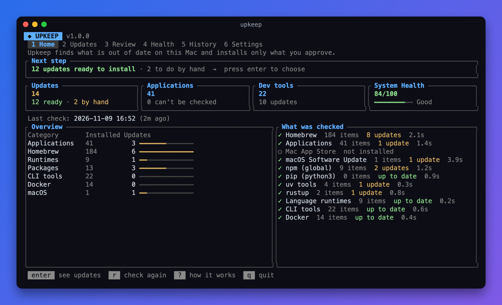
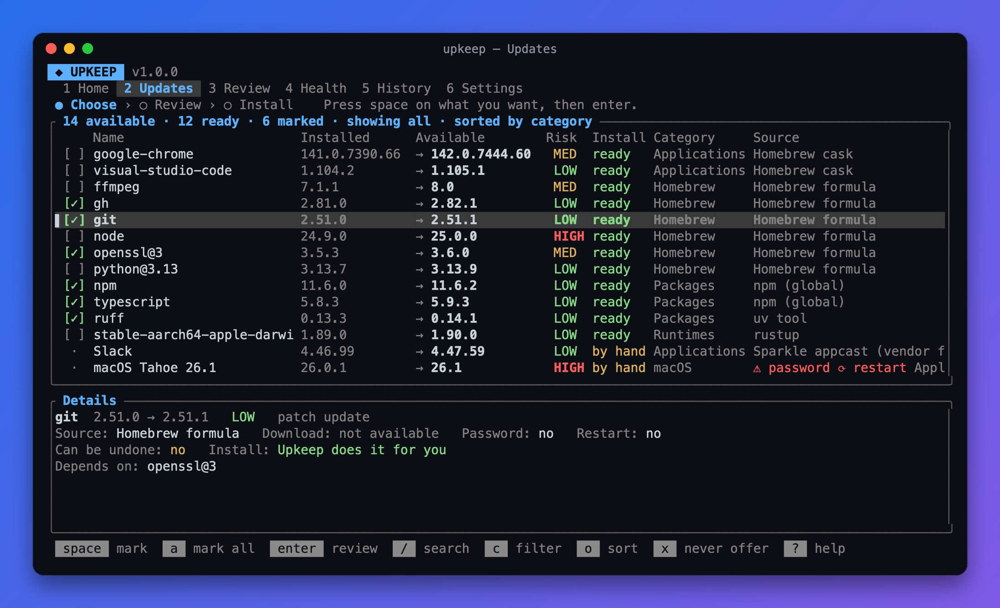
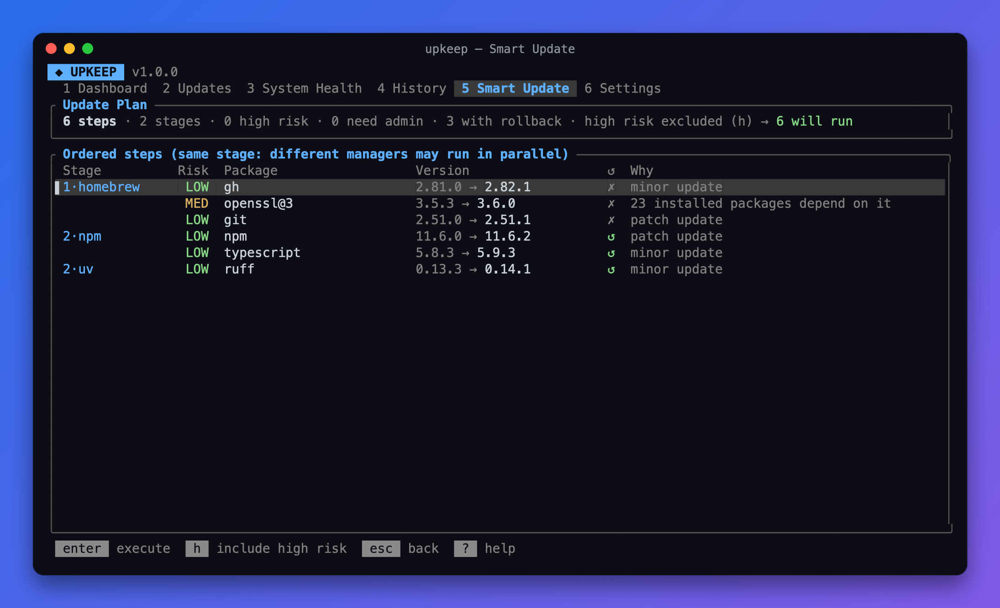
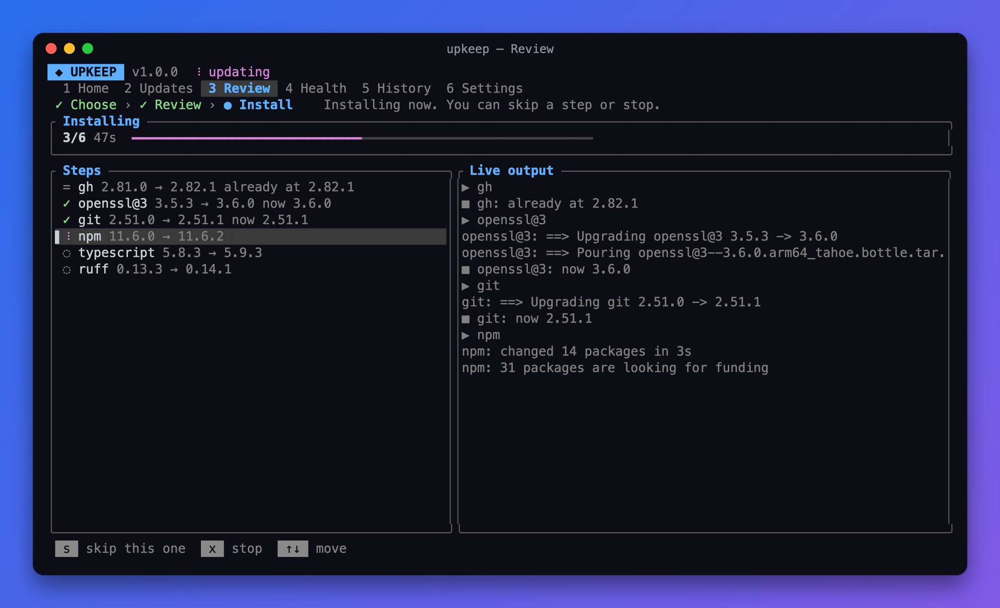
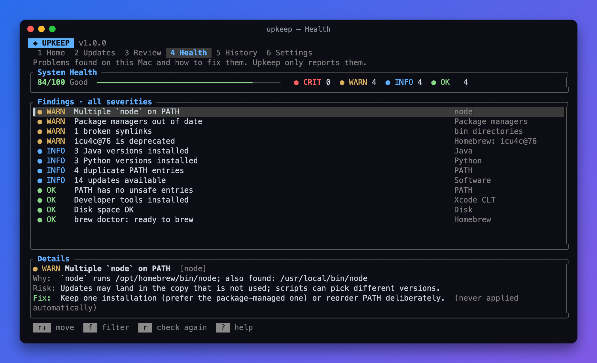
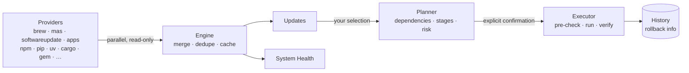

<div align="center">


# Upkeep

**Keep your whole Mac up to date from one terminal app — safely.**

Updates for Homebrew, the App Store, macOS, self-updating apps, language package managers
and runtimes, with a dependency-aware plan, risk analysis, history and rollback.


[Features](#features) · [Install](#install) · [Usage](#usage) · [How it works](#how-it-works) · [Safety](#safety)



</div>

## Why

A developer Mac collects software from a dozen places: Homebrew formulae and casks, the
App Store, macOS updates, apps that update themselves, `npm -g`, `pip`, `uv`, `cargo`,
`rustup`, several Java and Python versions… Each has its own command, and none of them
tells you whether upgrading one will break another.

Upkeep finds everything in one scan, tells you what is outdated and how risky each
update is, builds an ordered plan, and runs it only after you confirm. It never deletes
anything and never uses `sudo` behind your back.

## Features

<table>
<tr>
<td width="50%" valign="top">

**Update Manager**<br>
One list across every source, with installed and available version, source, risk,
admin/restart flags and whether Upkeep can run it or you must do it by hand.

</td>
<td width="50%" valign="top">

**Review**<br>
Pulls in required dependencies, orders steps (dependencies first, package managers
after the runtimes they run on), rates risk with reasons and asks again for high-risk steps.

</td>
</tr>
<tr>
<td></td>
<td></td>
</tr>
<tr>
<td width="50%" valign="top">

**Live execution**<br>
Streaming output, skip or stop a step, controlled abort. Each result is verified by
re-reading the installed version: an exit code alone is never reported as success.

</td>
<td width="50%" valign="top">

**Health**<br>
A 0–100 score with Critical / Warning / Info / Healthy findings, each with the cause,
the risk and a suggested fix. Fixes are suggested, never applied for you.

</td>
</tr>
<tr>
<td></td>
<td></td>
</tr>
</table>

Also: persistent **update history** with search and filters, **rollback** where the
package manager supports it, per-package **exclusions**, enable/disable **providers**,
and every command available as plain CLI with `--json` output.

### What it covers

| Source | How it is checked | Upkeep can update | Rollback |
| --- | --- | :---: | :---: |
| Homebrew formulae & casks | `brew info` / `brew outdated` (JSON), dependency graph | ✅ | — |
| Mac App Store | [`mas`](https://github.com/mas-cli/mas) | ✅ | — |
| macOS, security updates, Xcode CLT | `softwareupdate --list` | ✅ sudo¹ | — |
| **Any app in /Applications**, even installed by hand | the vendor's Sparkle feed, else the Homebrew cask catalog | ✅ verified² | ✅ |
| Microsoft Office, Edge, Teams | Microsoft AutoUpdate (`msupdate`) | ✅ | — |
| npm · pnpm (global) | `outdated --json` | ✅ | ✅ |
| pip | `pip list --outdated` (Homebrew Python included, rated MED) | ✅ | ✅ |
| uv tools | `uv tool list --outdated` | ✅ | ✅ |
| cargo-installed crates | crates.io API | ✅ | ✅ |
| RubyGems · Composer (global) | `gem outdated` · `composer global outdated` | ✅ | ✅ |
| Rust toolchains | `rustup check` | ✅ | — |
| Runtimes: Java, Python, Node, Go, Ruby, PHP, .NET… | Homebrew Cellar, `java_home`, pyenv, nvm, fnm, Volta, rbenv, SDKMAN, uv | inventory³ | — |
| CLI tools: git, gh, claude, docker, code, cmake, terraform… | `--version` + which installer owns the binary | via their owner | — |
| Docker | Desktop version, engine, images | inventory | — |

<sub>¹ you type your password at the normal `sudo` prompt; Upkeep never restarts the Mac, it tells you when to.
² installed only if the download has the same bundle id, a valid signature **from the same developer (Team ID)** as the installed app, and passes Gatekeeper/notarization. The previous version is kept for rollback.
³ every installed version is listed separately (Java 17, 21 and 25 are three entries); none is ever removed.</sub>

## Install

Requirements: macOS 13+ and a Rust toolchain. Built and tested on Apple Silicon.

```sh
brew install rustup && rustup default stable     # skip if you already have Rust
git clone https://github.com/Sero3105/upkeep.git
cd upkeep
./install.sh                                     # builds and installs to ~/.local/bin/upkeep
upkeep doctor                                    # checks the installation
```

`PREFIX=/usr/local/bin ./install.sh` installs elsewhere. `./install.sh --uninstall` removes it and keeps your data.

**Upkeep updates itself.** On launch it checks whether its source directory changed or the
git upstream has new commits (fetched at most every 6 hours). If so, it rebuilds, swaps the
binary atomically and re-runs your command. If the build fails it keeps the current version.
Turn it off in Settings → *Auto-update Upkeep*, or update on demand with `upkeep self-update`.

## Usage

```sh
upkeep                 # interactive TUI
upkeep check           # what can be updated
upkeep update          # pick, review the plan, confirm, run
upkeep plan            # build the plan only: nothing changes
upkeep health          # System Health report
upkeep history         # past operations (--show ID, --rollback ID, --failed)
upkeep list            # installed software and versions
upkeep doctor          # verify Upkeep itself
```

| Option | Effect |
| --- | --- |
| `-c, --category LIST` | `apps,homebrew,runtimes,packages,tools,docker,system` |
| `-o, --only LIST` | only these packages, e.g. `-o gh,node` |
| `--json` | machine-readable output for `check`, `list`, `plan`, `health`, `history` |
| `--no-refresh` | skip the `brew update` index refresh for this run |

<details>
<summary><b>Keyboard shortcuts</b></summary>

| Where | Keys |
| --- | --- |
| Everywhere | `1`–`6` / `Tab` switch section · `r` rescan · `?` help · `q` quit |
| Updates | `Space` select · `a` select all compatible · `n` clear · `/` search · `c` category · `o` sort · `x` exclude · `Enter` build plan |
| Review | `Enter` install · `h` include high-risk steps · `Esc` back · while running: `s` skip/stop step, `x` abort |
| Health | `f` filter by severity |
| History | `Enter` details · `R` undo · `/` search · `f` failed only · `c` category |
| Settings | `Space` toggle option, provider or exclusion |

</details>

## How it works



1. **Scan.** Each provider runs in its own thread and only reads. A full scan of a real
   developer Mac takes about 4–5 s.
2. **Merge.** Duplicates between sources are removed: a Chrome installed by a cask is
   updated through the cask, not reported twice.
3. **Plan.**
   - Outdated dependencies are added and marked *needed by X*.
   - Package managers are grouped into stages: `npm`, `pip` and `gem` run after `homebrew`,
     because it may replace the runtime they use.
   - Inside one manager: self-update first, then dependencies before dependents.
   - Each step starts as soon as what it depends on is done: it never waits for an
     unrelated step listed above it. Up to N run at once, where N comes from your CPU
     cores and current load (2–8; set `"jobs": N` in `config.json` to fix it).
   - Homebrew downloads (`brew fetch`) start right away, side by side, so the install
     itself mostly unpacks. Vendor app downloads run fully in parallel.
   - Steps that share a tool (`brew`, `npm`, `pip`…) never overlap: those tools lock or
     share state. Steps needing your password run alone, so the `sudo` prompt stays readable.
4. **Risk.**
   - **High:** needs admin, needs a restart, or a minor/major jump of a language runtime.
   - **Medium:** major version, 5 or more installed dependents, deprecated, a downgrade
     offered by the source, or versions that can't be compared.
   - **Low:** everything else.
5. **Run.** Before each step Upkeep skips it if the target version is already installed.
   Output is streamed live, with a timeout per step. After each step it re-reads the
   installed version and saves a history record, including the rollback command when one exists.

### Architecture

```text
src/
├── main.rs            argument parsing, dispatch
├── cli.rs             non-interactive commands, line-based `upkeep update`
├── tui/               ratatui interface: state & input (mod.rs), rendering (view.rs)
├── engine.rs          parallel scan, merge, snapshot cache
├── planner.rs         dependency resolver, stages, risk analyzer
├── executor.rs        lanes, verification, skip/abort, rollback
├── health.rs          diagnostics and score
├── history.rs         append-only JSONL history
├── config.rs          settings, paths, logging
├── shell.rs           Runner trait: real processes (timeouts, streaming, setsid) and test mock
├── version.rs         version parsing and comparison
└── providers/         one module per source, all implementing `Provider`
```

**Adding a source** means implementing one trait and listing it in `providers::registry()`.
The engine, planner, executor and UI need no changes:

```rust
pub trait Provider: Send + Sync {
    fn id(&self) -> &'static str;
    fn name(&self) -> &'static str;
    fn category(&self) -> Category;
    fn after(&self) -> &'static [&'static str] { &[] }   // managers that must update first
    fn available(&self, ctx: &Ctx) -> bool;
    fn scan(&self, ctx: &Ctx) -> Result<ScanResult, String>;
    fn installed_version(&self, ctx: &Ctx, name: &str) -> Option<String> { None }
}
```

## Safety

- **No update without explicit confirmation.** There is no `--yes`; high-risk steps
  need a second, specific confirmation.
- **`sudo` only with your password, after your confirmation.** Steps that need it run in
  the normal terminal where you type the password as usual (the TUI pauses and resumes).
  Everything else runs without a controlling terminal, so nothing can prompt behind your back.
- **Nothing is deleted.** Old runtime versions, Docker images, volumes and containers
  stay. Cleanups such as `brew autoremove` or `docker image prune` are only suggested in Health.
- **Your projects are off-limits.** Project dependencies and virtual environments are
  never modified. pip is skipped entirely inside `VIRTUAL_ENV` / `CONDA_PREFIX`.
- **Official channels, verified.** Package managers, the App Store, Apple, Microsoft
  AutoUpdate, vendor HTTPS feeds and the Homebrew cask catalog (vendor URLs, sha256).
  An app is replaced only by a build signed by the same developer as the one you have.
- **Honest status.** Each update is *supported*, *manual* or *not verifiable*. After a
  run each step is *success* (verified), *unverified*, *failed*, *skipped* or
  *already current*. Every command that changes the system is logged.

## Performance

Measured on Apple Silicon, scanning a real developer machine (126 installed items,
15 providers):

| Metric | Value |
| --- | --- |
| Binary size | 1.3 MB (arm64, stripped, LTO) |
| Runtime dependencies | none (links only `libSystem`) |
| Peak memory of Upkeep | ~7 MB |
| Full scan | ~4–5 s, bounded by `brew` and `softwareupdate` |

## Development

```sh
cargo test                       # 45 tests: mocked commands and temp dirs, nothing is installed
cargo clippy --all-targets -- -D warnings
cargo build --release
./scripts/screens.sh             # regenerate the README screenshots (demo data, real renderer)
```

Data lives in `~/.config/upkeep/` (`config.json`, `history.jsonl`, `last-scan.json`,
`upkeep.log`). Set `UPKEEP_HOME` to move it.

## Limitations

- Homebrew, the App Store, macOS and rustup can't install older versions, so they have
  no rollback. The plan says so before anything runs.
- Electron apps updating through Squirrel keep their feed inside the app: they are marked
  *updates itself when opened*. Apps with no channel at all are *not verifiable*, never guessed.
- macOS may ask you to allow your terminal under **Privacy & Security → App Management**
  the first time Upkeep replaces an app.
- Checking whether a Docker image has a newer tag would need a `docker pull`, so it isn't done.
- Download sizes appear only when the source reports them (macOS updates).

## License

[MIT](LICENSE)
